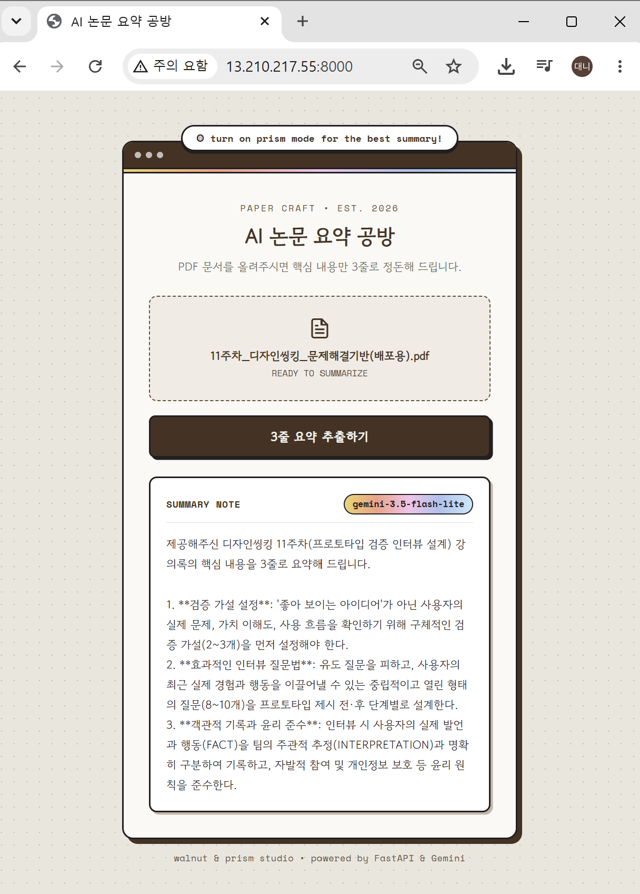
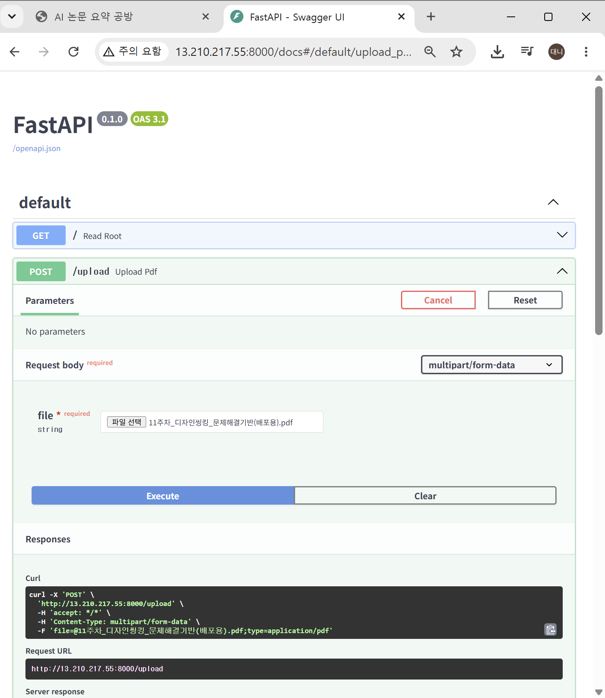
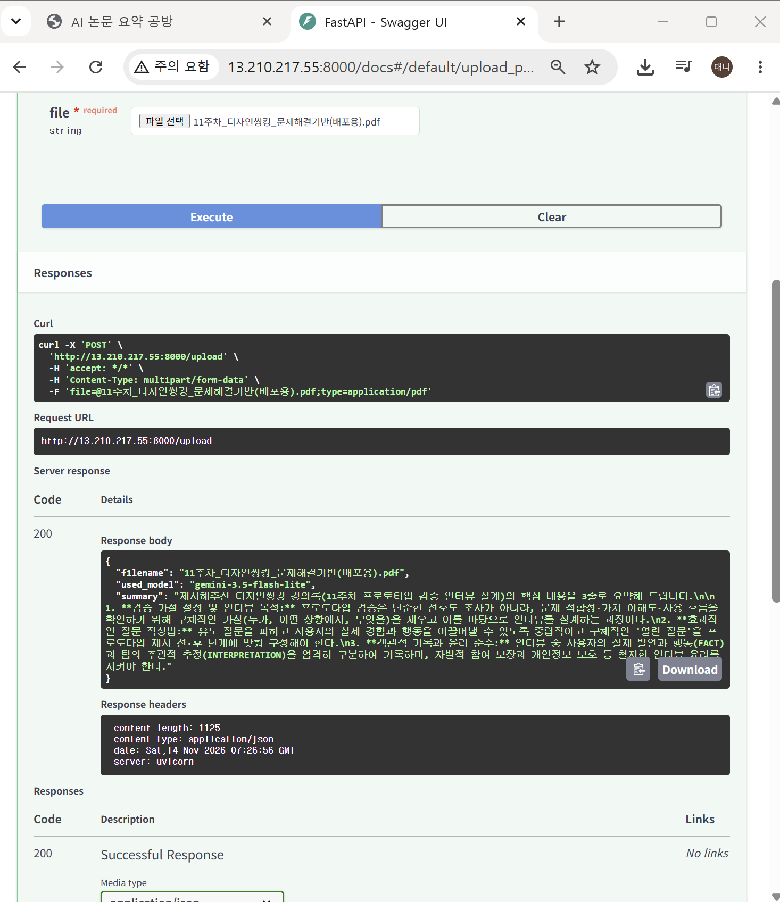
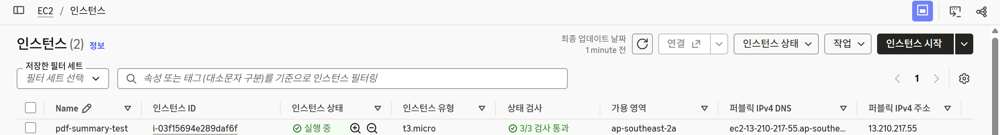
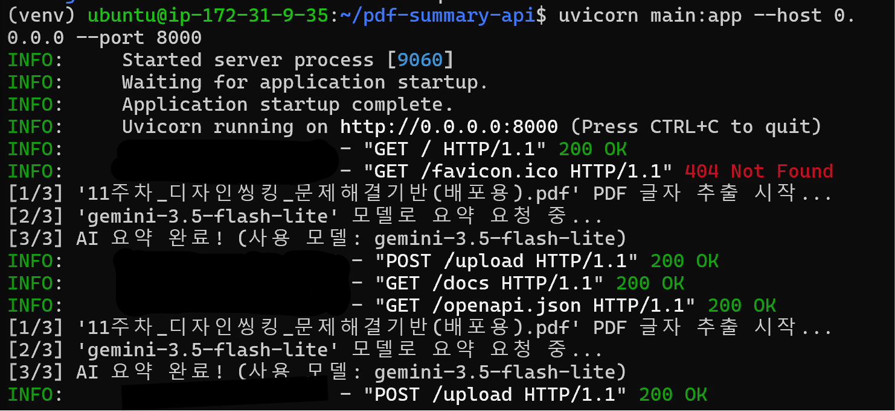
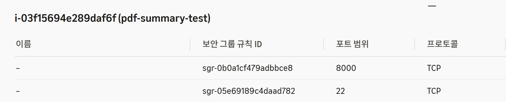

# AI 논문 요약 공방 (pdf-summary-api)

복잡한 PDF 학술 논문이나 전공 문서를 업로드하면 핵심 내용을 3줄로 깔끔하게 요약해 주는 웹 서비스입니다.  
**FastAPI** 백엔드 서버가 PDF에서 텍스트를 추출·분할하고, **Google Gemini API**의 다중 모델 전환(Fallback) 파이프라인을 통해 안정적으로 요약 결과를 반환합니다.

> **클라우드 배포 및 인프라 검증 완료**  
> 로컬 개발에 그치지 않고 **AWS EC2(Ubuntu 24.04)** 실서버 환경에 배포하여 외부 접속과 API 동작을 검증한 뒤, 클라우드 비용 최적화를 위해 인스턴스를 안전하게 종료(Terminate)하는 전체 수명주기를 실습했습니다. ([하단 작동 화면 보기](#-aws-ec2-클라우드-배포-및-검증))

---

## 주요 기능

* **PDF 텍스트 추출 및 전처리 (`pypdf`)**: 업로드된 PDF에서 페이지별 텍스트를 추출하고 줄바꿈(`\n`) 경계를 보존해 문맥 깨짐을 방지합니다.
* **토큰 최적화 텍스트 분할 (Chunking)**: 대용량 문서 업로드 시 응답 지연과 토큰 과부하를 막기 위해 핵심 본문(3,000자) 단위로 데이터를 제어합니다.
* **무중단 AI 요약 파이프라인 (Model Fallback)**: 특정 모델의 트래픽 과부하(`503 Service Unavailable`) 발생 시, `gemini-3.5-flash-lite` ➔ `gemini-3.6-flash` ➔ `gemini-3.8-flash` 순서로 자동 우회하여 요약 성공률을 높였습니다.
* **커스텀 웹 UI & Swagger 문서 동시 지원**: 일반 사용자를 위한 **Walnut Wood & Prism** 컨셉의 웹 화면(`/`)과 개발자 테스트용 Swagger UI(`/docs`)를 모두 제공합니다.

---

## 기술 스택

| 구분 | 사용 기술 | 상세 역할 |
| :--- | :--- | :--- |
| **Backend** | Python, FastAPI, Uvicorn | 비동기 REST API 서버 구축 및 정적 웹 페이지 서빙 |
| **PDF Parsing** | pypdf | PDF 문서 내 텍스트 스트림 추출 |
| **AI Model** | Google Gemini API (`google-genai`) | 학술 문서 3줄 요약 생성 및 다중 모델 Fallback 처리 |
| **Frontend** | HTML5, CSS3, Vanilla JS | Fetch API 기반 비동기 파일 업로드 및 커스텀 UI |
| **Infra / Cloud** | AWS EC2 (Ubuntu 24.04 LTS) | 리눅스 서버 환경 구축, 보안 그룹 제어 및 실서버 배포 검증 |
| **Security** | python-dotenv, `.gitignore` | 환경변수(`.env`) 분리를 통한 API 키 보안 관리 |

---

## 폴더 구조

```text
pdf-summary-api/
├── main.py            # FastAPI 서버 및 PDF 추출·AI 요약 파이프라인
├── index.html         # 일반 사용자용 웹 프론트엔드 (Walnut & Prism UI)
├── requirements.txt   # 파이썬 의존성 패키지 명세서
├── capture/           # 로컬 및 AWS EC2 배포 작동 화면 캡처
├── .gitignore         # .env, venv 등 보안 및 가상환경 파일 업로드 제외
└── .env               # Gemini API 키 보관 (Git 추적 제외)
```

---

## 내 PC에서 실행하기 (Local Setup)

### 1. 저장소 복제 및 폴더 이동
```bash
git clone [https://github.com/kwakminu/pdf-summary-api.git](https://github.com/kwakminu/pdf-summary-api.git)
cd pdf-summary-api
```

### 2. 가상환경 생성 및 패키지 설치 (Windows PowerShell 기준)
```powershell
python -m venv venv
.\venv\Scripts\activate
pip install -r requirements.txt
```

### 3. 환경변수(`.env`) 파일 설정
프로젝트 루트 경로에 `.env` 파일을 생성하고 본인의 Google Gemini API 키를 입력합니다.
```env
GEMINI_API_KEY="여기에_본인_API_키_입력"
```
> `.env` 파일은 `.gitignore`에 등록되어 있어 GitHub에 업로드되지 않습니다.

### 4. 로컬 서버 실행
```powershell
uvicorn main:app --reload
```
* **일반 사용자용 웹 화면**: `http://127.0.0.1:8000`
* **개발자용 API 테스트 화면**: `http://127.0.0.1:8000/docs`

---

## API 명세

| 메서드 | 경로 | 설명 |
| :---: | :--- | :--- |
| `GET` | `/` | 일반 사용자용 AI 논문 요약 웹 화면(`index.html`) 반환 |
| `POST` | `/upload` | PDF 파일(`multipart/form-data`) 업로드 후 3줄 요약 JSON 반환 |
| `GET` | `/docs` | FastAPI 자동 생성 Swagger UI 제공 |

### 응답 예시 (`POST /upload`)
```json
{
  "filename": "인공지능_8 (1).pdf",
  "used_model": "gemini-3.5-flash-lite",
  "summary": "1. 지식 표현 언어의 한계: 프로그래밍 언어와 명제 논리는 추론 능력이나 객체 표현력에서 한계가 있습니다.\n2. 1계 논리(First-Order Logic)의 도입: 객체, 관계, 함수를 바탕으로 복잡한 환경을 간결하고 명확하게 표현합니다.\n3. 모델과 해석(Interpretation): 기호를 실제 객체·관계·함수에 대응시키는 해석으로 구성됩니다."
}
```

---

## AWS EC2 클라우드 배포 및 검증

로컬에서 완성한 서버를 실제 클라우드 인프라(**AWS EC2**)에 이식하여 외부 네트워크 접속을 검증한 뒤, 불필요한 과금과 API 키 노출을 막기 위해 인스턴스를 완전히 종료(Terminate)했습니다. *(아래 캡처 화면의 퍼블릭 IP는 현재 종료되어 접속할 수 없습니다.)*

### 배포 인프라 환경
| 항목 | 설정 내용 |
| :--- | :--- |
| **리전 (Region)** | 아시아 태평양 (시드니) `ap-southeast-2` |
| **운영체제 (OS)** | Ubuntu Server 24.04 LTS |
| **인스턴스 유형** | `t3.micro` (AWS 프리티어) |
| **보안 그룹 (방화벽)** | `22`(SSH), `8000`(FastAPI 웹 포트) — 보안을 위해 **내 IP에서만 접속 허용** |

### 클라우드 배포 과정
1. **EC2 인스턴스 생성**: Ubuntu 24.04 LTS, `t3.micro` 인스턴스 생성 및 `.pem` 키 페어 발급
2. **원격 접속 및 패키지 세팅**: SSH 접속 후 `python3-pip`, `python3-venv`, `git` 설치
3. **소스 코드 배포**: `git clone`으로 저장소 복제 후 가상환경(`venv`) 생성 및 `pip install -r requirements.txt` 일괄 설치
4. **서버 환경변수 주입**: GitHub에 포함되지 않은 `.env` 파일을 리눅스 서버 내부에 직접 생성
5. **외부 접속 바인딩 실행**: `uvicorn main:app --host 0.0.0.0 --port 8000` 명령어로 외부 요청 수신 대기
6. **방화벽 개방 및 검증**: AWS 보안 그룹 인바운드 규칙에 `8000`번 포트를 개방하고 퍼블릭 IP로 접속해 PDF 요약 테스트 완료 후 인스턴스 종료(Terminate)

---

## 실제 작동 화면

### 1) 클라우드 실서버 웹 화면에서 PDF 요약
실제 퍼블릭 IP(`13.210.217.55:8000`)로 접속해 PDF 문서를 업로드하고 3줄 요약 결과를 정상적으로 수신했습니다.



### 2) Swagger UI (`/docs`) API 요청 및 응답
`POST /upload` 엔드포인트 호출 시 `200 OK` 상태 코드와 함께 사용된 모델명 및 요약 JSON이 반환됩니다.

 

### 3) AWS EC2 인스턴스 가동 상태
인스턴스가 정상 실행(Running) 중이며 상태 검사(`3/3 검사 통과`)를 완료한 화면입니다.



### 4) 리눅스 서버 실시간 처리 로그
외부 클라이언트의 접속 및 `POST /upload` 요청이 `200 OK`로 정상 처리된 Uvicorn 서버 터미널 로그입니다.



### 5) AWS 보안 그룹 인바운드 규칙 설계
최소 권한 원칙에 따라 SSH(`22`)와 웹 서버(`8000`) 포트만 개방하고 허용 소스를 내 IP로 제한했습니다.



---

## 트러블슈팅 및 엔지니어링 인사이트

* **AI API 서버 혼잡(`503 UNAVAILABLE`) 대응**
  * **문제**: 기본 모델 호출 시 일시적인 트래픽 집중으로 `503` 에러와 함께 응답이 지연되는 현상 발생.
  * **해결**: SDK 자체 재시도와 중복되던 루프를 제거하고, 가벼운 모델(`gemini-3.5-flash-lite`)부터 상위 모델까지 순차적으로 전환하는 **Fallback 리스트 구조**를 도입해 응답 속도와 안정성을 확보했습니다.
* **로컬 전용 주소(`127.0.0.1`)와 외부 접속 바인딩(`0.0.0.0`)의 차이**
  * **원인**: EC2에서 기본 옵션으로 서버를 켜면 서버 자기 자신만 접속할 수 있어 외부 브라우저 접속이 거부됨.
  * **해결**: `--host 0.0.0.0` 옵션을 부여해 모든 네트워크 인터페이스의 요청을 수신하도록 설정하고, AWS **보안 그룹(Security Group)**에서 `8000`번 인바운드 포트를 내 IP에 개방하여 접속을 해결했습니다.
* **환경변수(`.env`) 보안 분리와 서버 수동 주입**
  * **인사이트**: API 키 유출을 막기 위해 `.gitignore`로 `.env`를 제외했으므로, 클라우드 서버에 `git clone`을 한 뒤에는 리눅스 터미널에서 직접 `.env` 파일을 생성해 키를 주입해야 함을 체득했습니다.
* **Windows SSH `.pem` 키 파일 권한 오류 해결**
  * **해결**: Windows 환경에서 SSH 접속 시 키 파일의 권한이 너무 열려 있으면 접속이 거부(`UNPROTECTED PRIVATE KEY FILE`)되므로, 파일 속성에서 상속을 비활성화하고 현재 사용자 외 권한을 제거해 인증을 통과했습니다.
* **클라우드 리소스 정지(Stop) vs 종료(Terminate)**
  * **인사이트**: 인스턴스를 단순 '중지(Stop)'하면 연결된 디스크(EBS) 용량에 대한 비용이 계속 청구될 수 있으므로, 테스트 완료 후에는 반드시 **'종료(Terminate)'**를 통해 리소스를 완전히 반납해야 함을 확인하고 해당 리전(`ap-southeast-2`)에서 삭제를 완료했습니다.

---

## 프로젝트 개발 로드맵

- [x] **1단계**: 로컬 개발 환경(가상환경) 구축 및 Git/GitHub 보안 세팅(`.gitignore`)
- [x] **2단계**: FastAPI 기본 웹 서버 구동 및 PDF 파일 업로드 엔드포인트 구현
- [x] **3단계**: `pypdf` 텍스트 추출 및 Google Gemini API 요약 파이프라인(Fallback) 구축
- [x] **4단계**: 일반 사용자용 커스텀 프론트엔드(`index.html`) 설계 및 서버 연동
- [x] **5단계**: AWS EC2 리눅스 서버 배포, 방화벽 설정 검증 및 리소스 종료(Terminate)